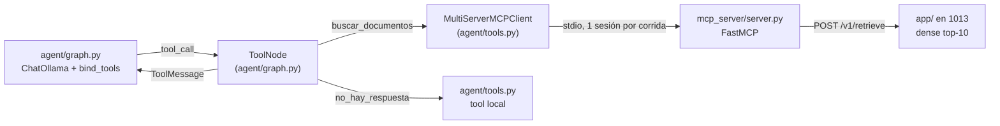

# Integración del servidor MCP con el agente

**La integración funciona como está diseñada: el resultado del [benchmark](./README.md) no viene de una herramienta mal conectada.** El modelo recibe las dos herramientas, `buscar_documentos` devuelve los 10 chunks completos con sus tablas, no hubo errores en las 34 llamadas y la consulta que reescribe el agente recupera casi lo mismo que la pregunta original. Queda una diferencia sin medir: el agente recibe los chunks como JSON escapado y el pipeline como texto plano.

## Cómo se integra



| Pieza | Archivo | Qué hace |
| --- | --- | --- |
| Servidor MCP | `mcp_server/server.py` | `FastMCP("scribe-lab")` por stdio, con `buscar_documentos` y `preguntar` |
| Herramientas del servidor | `mcp_server/tools.py` | `buscar_documentos(consulta, top_k=5)` → `/v1/retrieve`, con `doc_id`, `chunk_index`, `score` y `texto` (texto + tablas) por chunk. `preguntar(pregunta)` → `/v1/query` |
| Cliente MCP | `agent/tools.py` | `agent_tools()` arranca `python -m mcp_server.server` con `SCRIBE_API_URL`, abre una sola sesión y carga las herramientas con `load_mcp_tools`. Del servidor solo toma `buscar_documentos`, y suma `no_hay_respuesta` local |
| Grafo | `agent/graph.py` | Nodo del modelo con `bind_tools`, nodo de herramientas con `ToolNode(handle_tool_errors=True)` que mide cada llamada, corte por `no_hay_respuesta`, 6 pasos o 24 000 tokens |
| Prompt | `agent/prompts.py` | Buscar con `top_k=10` antes de responder, responder solo con los fragmentos y citar `[doc_id]`, o llamar a `no_hay_respuesta` |

`preguntar` no se le da al agente: es la respuesta completa del pipeline, pensada para clientes externos como Claude Code.

## Cómo se usa

```bash
docker compose -f docker-compose-prod.yml up -d
python -m agent "¿Qué método se usó para calibrar los rangos LO/HI?"   # agente: imprime AgentResult en JSON
python -m mcp_server.server                                         # servidor solo, por stdio
claude mcp add scribe-lab -- python -m mcp_server.server             # registrar en Claude Code
```

Los comandos se corren desde la raíz del repo. `SCRIBE_API_URL` elige la API (por defecto `http://127.0.0.1:1013`) y `LLM_MODEL_AGENT` el modelo del agente. El agente necesita Ollama en `127.0.0.1:1014`.

## Verificación

Sobre las 34 corridas del agente del benchmark (`exp_1`, `llama3.1:8b`) y con llamadas directas al servidor:

| Posible fallo de integración | Cómo se verificó | Resultado |
| --- | --- | --- |
| El modelo no recibe las herramientas | Herramientas que `bind_tools` envía a Ollama | Las dos: `buscar_documentos` y `no_hay_respuesta`, con su descripción y esquema |
| El resultado llega recortado | `ToolMessage` de una corrida y conversión de `langchain-ollama` a mensajes de Ollama | 10 bloques de texto, uno por chunk; `langchain-ollama` los concatena con saltos de línea, sin descartar ninguno |
| Faltan las tablas | Llamada directa a `buscar_documentos` con una consulta sobre la matriz de confusión | El chunk con tabla llega con la tabla en `texto` |
| La herramienta falla | Campo `error` de las 34 llamadas | 0 errores |
| El agente pide menos contexto | `top_k` de las 34 llamadas | `10` en todas (`llama3.1:8b` lo manda como texto y el servidor lo convierte) |
| La consulta reescrita recupera peor | `/v1/retrieve` con la pregunta original y con la consulta del agente, criterio `is_chunk_correct` de `shared/eval/metrics.py`, en las 31 preguntas con gold spans | `recall@10` 26/31 con la pregunta y 25/31 con la consulta del agente. Solo se pierde `q019`, y ninguna se gana (McNemar exacto p=1.0). Comparten 7 de los 10 chunks en la mediana (mínimo 2) |
| La capa MCP agrega latencia | Latencia de la herramienta contra la recuperación directa del pipeline | 74 ms contra 64 ms de p50 |
| `no_hay_respuesta` no es alcanzable | Test con modelo guionado (`test_no_hay_respuesta_ends_with_abstention` en `tests/unit/test_agent.py`) y herramientas enviadas a Ollama | El grafo corta con abstención cuando se la llama, y el modelo la recibe. `llama3.1:8b` no la llamó en ninguna de las 34: se abstuvo en texto en 6, según la etiqueta humana |

La comparación de recuperación se reproduce leyendo la `consulta` de cada llamada en el `answers_agent.csv` que escribe [run.py](./run.py) y pidiendo `/v1/retrieve` con esa consulta y con la pregunta de `shared/eval/questions.jsonl`.

## Lo que la verificación no descarta

- **Formato del resultado.** FastMCP serializa cada chunk como un objeto JSON con sangría, así que el modelo lee las comillas escapadas (`\"`) y los saltos de línea de las tablas como `\n` literales. El pipeline recibe el mismo contenido como texto plano (`[doc_id] texto`, con las tablas debajo, `chunk_block` de `shared/prompts.py`). Es la única diferencia de entrada entre los dos lados, y su efecto no se midió.
- **Uso de las herramientas.** El modelo nunca vuelve a buscar ni llama a `no_hay_respuesta`: la integración se lo permite, pero `llama3.1:8b` con este prompt no lo elige. Es comportamiento del modelo y del prompt, no del MCP.

Probar el resultado como texto plano o un prompt que fuerce `no_hay_respuesta` genera respuestas nuevas, que necesitan etiqueta humana nueva. **Diferido:** con el tiempo acotado, antes de mejorarlo se avanza con la arquitectura de servicio y el despliegue.
