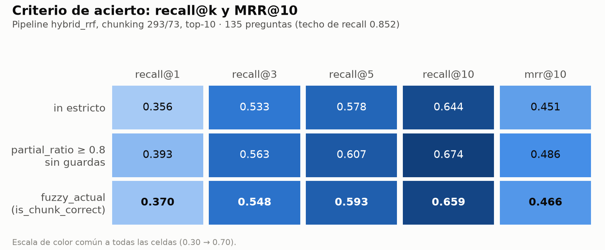

# Metodología de evaluación — criterio de acierto y ground truth

Todos los `recall@k` y `mrr@k` del proyecto dependen de una sola decisión: si un chunk recuperado cuenta como acierto. La toma `is_chunk_correct()` (`shared/eval/metrics.py`), que compara el chunk contra el **ground truth** del proyecto, los `gold_spans` de las preguntas en [`questions/`](./questions/). La usan los experimentos de chunking, hybrid search, reranking, abstención, conversación y agente.

| Área | Qué resuelve este documento |
|---|---|
| Ground truth | Set de preguntas, formato y reglas que debe cumplir cada gold span |
| Evaluación con métricas | Criterio de acierto de retrieval y su efecto sobre `recall@k`/`mrr@k` |
| Decisiones de calidad | Qué rechaza cada guarda del criterio sobre el pipeline |
| Data quality | Chequeo automático de que el ground truth sigue literal en el corpus |
| Testing + CI | Tests unitarios y de regresión que fijan el criterio, corridos en CI |

## Ground truth

135 preguntas sobre los 5 documentos de `corpus_demo/music-tagger/`. `load_questions()` (`shared/eval/data.py`) lee todos los `.jsonl` de `shared/eval/questions/` (`settings.questions_path`) y los ordena por `id`.

| Archivo | Preguntas | Tipos |
|---|---|---|
| `questions_base.jsonl` | 34 | 18 `simple`, 11 `comparativa_mismo_doc`, 3 `comparativa_entre_docs`, 2 `sin_respuesta` |
| `preguntas_simples.jsonl` | 19 | `simple` |
| `preguntas_varias_partes.jsonl` | 44 | `comparativa_mismo_doc` |
| `preguntas_comparativas_entre_docs.jsonl` | 20 | `comparativa_entre_docs` |
| `preguntas_sin_respuesta.jsonl` | 18 | `sin_respuesta` |

| Tipo | Preguntas | Gold spans | Regla |
|---|---|---|---|
| `simple` | 37 | 41 | Al menos 1 span |
| `comparativa_mismo_doc` | 55 | 118 | Al menos 2 spans |
| `comparativa_entre_docs` | 23 | 56 | Al menos 2 spans |
| `sin_respuesta` | 20 | 0 | Ningún span; `source_doc` es `"no encontrado en el corpus"` |
| **Total** | **135** | **215** | |

Cada línea tiene `id`, `library`, `tipo`, `question`, `expected_answer`, `source_doc` (uno o más documentos separados por `;`) y `gold_spans`.

Un gold span tiene que ser **texto literal de su fuente** y contener el **núcleo de la respuesta**. Es la referencia contra la que se mide todo lo demás, y el matching tolerante no debe tapar errores del dato. `gold_spans` solo se usa en las métricas de retrieval; `expected_answer` es la referencia de las métricas generativas (grounding, juez).

### Denominador del recall

`recall_at_k` divide por las 135 preguntas. Las 20 `sin_respuesta` no tienen `gold_spans` y nunca pueden contar como acierto, así que el techo es **115/135 = 0.852**. Para medir solo las preguntas con respuesta, hay que filtrarlas antes de llamar a `recall_at_k`.

## Criterio de acierto de retrieval

Un chunk es acierto si cumple las cuatro condiciones, en este orden, para alguno de los gold spans de la pregunta.

1. **Documento correcto** — `chunk["doc_id"]` está entre los `source_doc` de la pregunta.
2. **Similitud léxica** — sobre texto normalizado (`_normalize`: minúsculas, sin `**`/`__`, espacios colapsados) y con el `text` del chunk unido a sus tablas (`text_content`) por un espacio, `fuzz.partial_ratio_alignment(span, chunk)` da un score `≥ 0.8`.
3. **Cobertura del span** — `min(largo alineado en el span, largo alineado en el chunk) / len(span) ≥ 0.9`. Detecta chunks truncados.
4. **Consistencia numérica** — los números del span (`_find_numbers`) aparecen en el mismo orden dentro de la ventana del chunk que hizo match, no en cualquier otra parte del chunk.

| Condición | Tolera | Rechaza (evita falsos positivos) |
|---|---|---|
| Score `≥ 0.8` | Espacios, pipes de tabla, un typo, una redacción levemente distinta | Texto que no se parece |
| Cobertura `≥ 0.9` | Diferencias menores en los bordes del span | Chunks truncados que contienen solo una parte del span |
| Números en la ventana | Cifras idénticas en orden | Cifras invertidas, cambiadas o ausentes, aunque el resto de la oración coincida |

## Por qué matching tolerante con guardas

Los dos extremos fallan en direcciones opuestas.

- **`in` estricto** (`_normalize(span) in chunk`) — exige cada carácter. Cualquier diferencia de transcripción entre el gold span y el chunk (un backtick, una celda de tabla con otro padding) produce un **falso negativo** y subestima el recall.
- **`partial_ratio` sin guardas** — busca la cadena más corta dentro de la más larga, sin dirección. Si el chunk está truncado, termina midiendo *el chunk dentro del span* y da un score alto aunque falte la mitad de la respuesta. Tampoco distingue `22050, no 44100` de `44100, no 22050`, ni nota que falta la cifra. Produce **falsos positivos** y sobreestima el recall.

En chunking el segundo caso es crítico: el truncamiento es justamente lo que un barrido de `chunk_size` tiene que penalizar. La cobertura devuelve esa sensibilidad sin perder la tolerancia, y la consistencia numérica cubre las cifras alteradas o ausentes.

## Comparación de criterios sobre el pipeline

Top-10 de `hybrid_rrf` (dense + BM25 con RRF) sobre la colección `exp_hybrid_search` (chunking `293/73`, la configuración de `app/config/pipeline.yaml`), las 135 preguntas, evaluado con cada criterio. `fuzzy_actual` reproduce los números de `experiments/hybrid-search/results/results_135q.json`.

| Criterio | `recall@1` | `recall@3` | `recall@5` | `recall@10` | `mrr@10` |
|---|---|---|---|---|---|
| `in` estricto | 0.356 | 0.533 | 0.578 | 0.644 | 0.451 |
| `partial_ratio ≥ 0.8` sin guardas | 0.393 | 0.563 | 0.607 | 0.674 | 0.486 |
| **`fuzzy_actual`** (`is_chunk_correct`) | **0.370** | **0.548** | **0.593** | **0.659** | **0.466** |

- **Contra el `in` estricto**, `fuzzy_actual` suma 2 preguntas en el top-10 (`q033`, `q058`) y no pierde ninguna: el gold span está en el chunk con diferencias de formato.
- **Contra el fuzzy sin guardas**, `fuzzy_actual` rechaza 2 preguntas (`q056`, `q073`), y las dos por el chequeo numérico. El chunk tiene la oración pero no la cifra que es la respuesta: *"medidos sobre el dataset completo (n=1015 segmentos)"* contra un chunk que dice *"…sobre el dataset completo por segmento"*, y *"`alta-ritmica`=11"* contra un chunk que nombra la categoría sin el conteo. Son falsos positivos bien rechazados.
- **La cobertura no cambia el recall a nivel pregunta en este pipeline.** El único par que rechaza (`q067`, rank 9, cobertura 0.218) es un chunk que solo trae el título del documento, y esa pregunta ya acierta con otro chunk. Su función es proteger los barridos de `chunk_size`, donde los chunks cortos truncan spans.

## Data quality del ground truth

[`tests/data/test_gold_spans.py`](../../tests/data/test_gold_spans.py) fija tres reglas sobre el set completo:

| Test | Qué exige | Qué detecta |
|---|---|---|
| `test_gold_spans_are_literal_in_source` | Todo gold span aparece literal (normalizado) en alguno de sus `source_doc`; si falla, lista cada span con el score del fragmento más cercano | Errores de transcripción, paráfrasis y **drift del corpus** (un documento reescrito deja spans huérfanos) |
| `test_question_ids_are_unique` | Ningún `id` repetido entre archivos | Colisiones al agregar preguntas |
| `test_gold_span_count_matches_the_question_type` | Cantidad de spans según el tipo (tabla de [Ground truth](#ground-truth)) | Comparativas con un solo span, `sin_respuesta` con spans |

Los 215 spans de las 135 preguntas son literales en `corpus_demo/` y los tres tests pasan. Necesita el corpus en `settings.corpus_dir`, por eso corre localmente (`pytest tests/data`) y no en CI.

Para investigar una pregunta que no entra al top-k, [`tests/data/ranking_report.py`](../../tests/data/ranking_report.py) (`python -m tests.data.ranking_report`) imprime el rank del primer acierto de cada pregunta en el top-100 de una colección. Un span literal que queda fuera del ranking suele ser un span mal elegido (una aclaración secundaria en lugar del núcleo de la respuesta), no un problema del retrieval.

## Latencias (p50 / p95)

`percentile()` (`shared/eval/metrics.py`) interpola linealmente entre los dos valores vecinos de la posición `k = (n − 1) · p / 100`, igual que `np.percentile` por defecto. Lo usan `latency_summary()` (los `p50_ms`/`p95_ms` de cada run en MLflow) y los tiempos de grounding y de relevancia de los experimentos generativos.

## Testing + CI

[`ci.yml`](../../.github/workflows/ci.yml) corre en cada push `ruff check .`, `lint-imports`, `pytest tests/unit` con cobertura sobre `shared/`, y exige cobertura `≥ 80 %` en `shared/eval/metrics.py` y `shared/retrieval.py`. Los tests del criterio no dependen del corpus.

- [`tests/unit/test_chunk_correct_synthetic.py`](../../tests/unit/test_chunk_correct_synthetic.py) — **casos sintéticos**. 6 que deben ser acierto (mismo dato con otro formato: idéntico, espacios y salto de línea, negrita, backticks, typo, fila de tabla con otro padding) y 8 que no (número cambiado, números invertidos con y sin los correctos en otra oración, número faltante, truncado al inicio y al final, misma estructura con otro modelo, documento equivocado).
- [`tests/unit/test_chunk_correct_real.py`](../../tests/unit/test_chunk_correct_real.py) — **regresión con chunks reales** ([`real_chunks.json`](../../tests/fixtures/real_chunks.json)): `q002`, `q014` y `q028` deben ser acierto y el chunk truncado de `q011` debe ser rechazo.
- [`tests/unit/test_metrics.py`](../../tests/unit/test_metrics.py) — `_find_numbers`, `recall_at_k`, `mrr`, `calculate_hit_at_k`, `percentile`, `latency_summary`, `bootstrap_ci`, `groundedness_rate`/`hallucination_rate`, `mcnemar_exact`, `wilson_ci`, `cohen_kappa` y `auroc`, sobre valores calculables a mano.

Un criterio sin guardas falla los 7 sintéticos de dato alterado y el real `q011`; el `in` estricto falla los sintéticos de backticks y typo y los reales `q002`, `q014` y `q028`. Una regresión en cualquiera de las dos direcciones rompe el CI.
